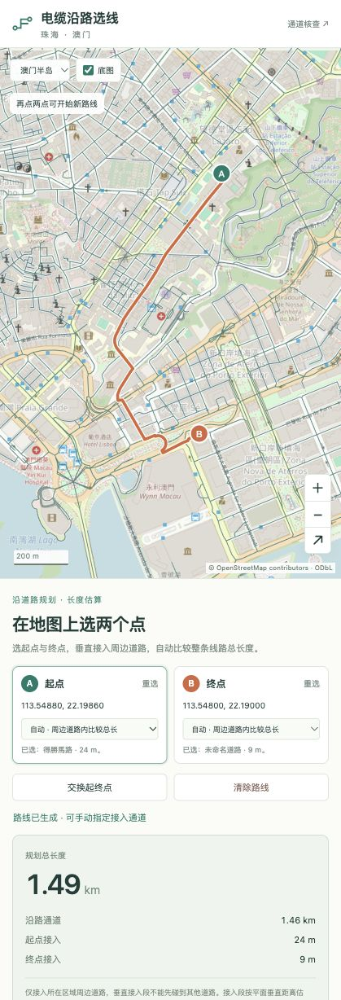

# Street Skeleton

从 OpenStreetMap 城市数据提取无向道路通道，并在地图上选两个设备位置，估算沿道路敷设的电缆长度。



图为珠海、澳门本地核查结果。仓库不附城市数据；其他城市需自行下载、处理。

## 使用

需要 Python 3.11 或更新版本。

```bash
python -m venv .venv
source .venv/bin/activate
python -m pip install .
python run.py
```

1. 在 [BBBike](https://extract.bbbike.org/) 框选城市，下载 **Protocolbuffer (PBF)** 格式。
2. 在本机页面导入 `.osm.pbf`，生成道路骨架。
3. 点击「电缆沿路选线」，在地图上选起点和终点。
4. 查看沿路长度、两端接入距离和总长，可手动切换接入位置、导出 GeoJSON。

也可生成并保存结果，之后直接打开选线地图：

```bash
python run.py city.osm.pbf --output outputs/city
python run.py --planner outputs/city
```

## 计算规则

只保留垂足落在真实道路线段上的接入方案；接入线不能先碰到其他道路。因此，被道路围住的点只接入周边边界道路，不能穿过近路去接远路。已有路上的点直接接入原位。

在有效候选中最小化：**起点垂直接入长度 + 沿路最短距离 + 终点垂直接入长度**。默认比较 200 米内候选，不连通时扩至 400、800 米；远离路网时先寻找最近的有效接入。桥隧保留层级，平面交叉不自动连通。

结果用于规划估算：道路简化可能有残留或缺口；接入边界按二维路网判断，尚未核查建筑、水体、实际管沟及施工条件，也未计竖向段与预留量。

数据 © [OpenStreetMap contributors](https://www.openstreetmap.org/copyright)，遵循 [ODbL](https://opendatacommons.org/licenses/odbl/1-0/)。城市数据与生成结果只在本机处理，不提交到仓库。
